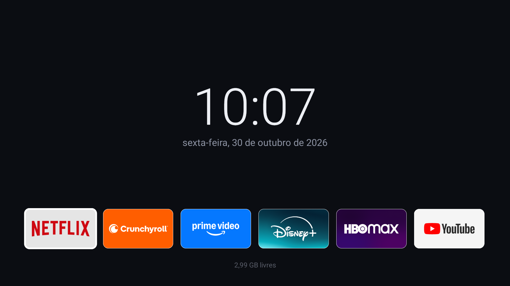
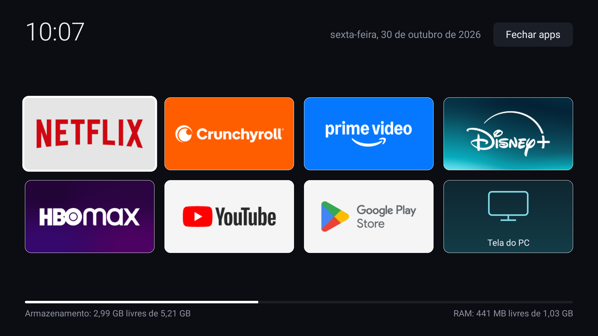
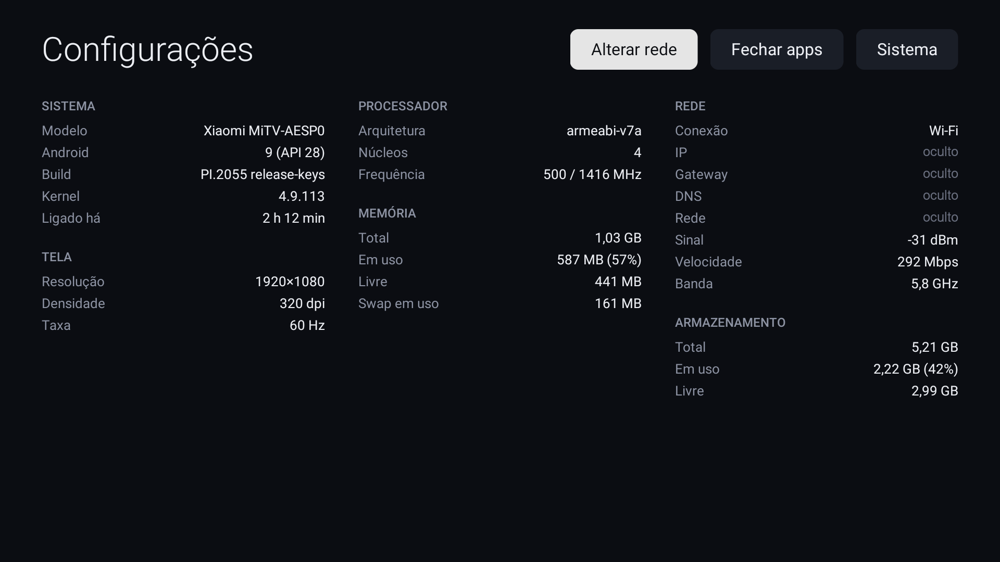

# TV Launcher

Um launcher minimalista e leve para **Android TV**, feito para o **Mi TV Stick** (Android 9). Troca a interface original da Xiaomi por uma tela inicial só com atalhos dos apps de streaming, sem exigir conta Google, mantendo os serviços essenciais do sistema.

APK de cerca de **1 MB**, em Kotlin com Jetpack Compose, navegação por controle remoto (D-pad) e build 100% em Docker.

## Telas

**Início**: relógio grande e uma fila com os atalhos.



**Apps**: grade completa, com armazenamento e RAM livres. Mostra também a Play Store e o spacedesk ("Tela do PC") quando instalados.



**Configurações**: dados de hardware e rede atualizados a cada 2 s (IP, gateway, DNS e nome da rede foram ocultados neste print).



## Recursos

- Atalhos para Netflix, Crunchyroll, Prime Video, Disney+, HBO Max e YouTube, usando o banner de cada app (nenhuma imagem de marca no projeto).
- Atalho "Tela do PC" para o spacedesk, com ícone próprio desenhado no código.
- Informações do sistema: modelo, Android, kernel, tempo ligado, tela, CPU, memória, swap, armazenamento e rede (tipo, IP, sinal, velocidade, banda).
- Botão **Alterar rede** (abre o Wi-Fi do Android) e **Sistema** (configurações completas).
- Botão **Fechar apps**: encerra os processos em segundo plano dos outros apps para liberar RAM.

## Controle remoto

| Botão | Ação |
|---|---|
| Home (toque) | Tela inicial |
| Home (segurar) | Configurações |
| Apps | Grade de apps |
| Voltar | Sai da grade ou das configurações |
| Busca (microfone) | Sem função: o firmware da Xiaomi consome esse botão antes de qualquer app |

O Android 9 manda os botões Home e Apps para o sistema, então o launcher usa um **serviço de acessibilidade** (`KeyService`) que lê essas teclas antes dele.

## Requisitos

- Docker (o JDK, o Android SDK e o `adb` rodam em containers; nada é instalado no host).
- Mi TV Stick com **Depuração USB** ativada (em Opções do desenvolvedor). O `adb` funciona por Wi-Fi na porta 5555, pois a USB do Stick serve só de energia.

## Compilar

```bash
./build.sh assembleRelease   # APK em app/build/outputs/apk/release/
```

A primeira execução cria a imagem `tv-launcher-build` (JDK 17, Gradle 8.7, SDK 34). O cache do Gradle e a chave de assinatura ficam em volumes Docker, então as atualizações seguintes instalam por cima.

## Instalar no Stick

```bash
./adb connect <IP-DO-STICK>:5555
./adb install -r app/build/outputs/apk/release/app-release.apk

# Ativa o serviço de teclas (repita depois de cada reinstalação)
./adb shell settings put secure enabled_accessibility_services dev.victor.tvlauncher/dev.victor.tvlauncher.KeyService
./adb shell settings put secure accessibility_enabled 1

# Permite mostrar o nome do Wi-Fi nas configurações
./adb shell pm grant dev.victor.tvlauncher android.permission.ACCESS_FINE_LOCATION
```

`./adb` é um script que roda o adb num container persistente (`tv-adb`), guardando a autorização do Stick num volume.

## Trocar o launcher

O Android sempre prefere o launcher de maior prioridade, e o do Google ganha de qualquer app instalado por nós. Por isso o botão Home só abre este launcher depois de desativar os originais:

```bash
./adb shell pm disable-user --user 0 com.google.android.tvlauncher
./adb shell pm disable-user --user 0 com.mitv.tvhome.atv
```

Para desfazer: `./adb shell pm enable <pacote>`. O script `restore-system-apps.sh` restaura a lista de pacotes de sistema que removi do meu Stick (`pm uninstall -k --user 0`, que não apaga nada da partição do sistema).

## Limitações

- **Temperatura da CPU**: o Android 9 só entrega esse dado a apps de sistema.
- **Botão de busca**: não pode ser remapeado sem root.
- **Play Store**: precisa de uma conta Google válida no aparelho; o launcher em si nunca pede conta.
- O APK `release` é assinado com a chave de debug, pensado para instalação pessoal (sideload).

## Estrutura

```
app/src/main/java/dev/victor/tvlauncher/
  MainActivity.kt      telas (Início, Apps, Configurações) e roteamento
  LauncherScreen.kt    interface em Compose
  KeyService.kt        serviço de acessibilidade que lê Home e Apps
  HardwareInfo.kt      leitura de hardware e rede
  SystemInfo.kt        armazenamento e RAM
docker/                imagens de build e de adb
build.sh  adb          wrappers que rodam tudo em containers
```

## Licença

MIT. Veja [LICENSE](LICENSE).
